# Batching lookups behind one call

A service that needs one row per request usually sends one query per request. Under load,
the round trips are the limit, not the database. Batching sends the requests that wait at the
same moment as one query, while every request still makes a single call and gets its own
answer.

## Why one query for many requests is faster



Every query pays a fixed cost: the trip to the database and back, and the work of parsing it
and sending the answer. Finding one row by primary key is cheap next to that. A batch pays
the fixed cost once for every key that is waiting.

The gain depends on how many requests wait at the same time. A single request has nothing to
share and takes as long as before. In the
[lookup benchmark](https://github.com/marcomq/mq-bridge/tree/main/benches/lookup), with 4,096
concurrent clients on one laptop, one query per request topped out at about 18,000 requests/s
and the batched version reached about 252,000. The benchmark's README lists the setup and its
limits.

## What happens inside `users.call(key).await`



1. Each request runs its own handler. It calls `users.call(key)`.
2. `call` registers a reply slot under a new id, then puts only the key and that id into a
   queue. `.await` parks the handler on its slot: no thread is blocked, so the same thread
   runs other requests meanwhile.
3. A separate task, the route, takes every call that is waiting right now. It does not wait
   for more.
4. It sends one query for all of their keys and gets all rows back in one round trip.
5. The route matches each row to its call by key and sends it to the reply slot with that
   call's id. That wakes the parked handler, and `call` returns its row.

The handler never sees the batch. It reads like a function that runs one query.

## Setting it up

The route holds the batched query. `IN (${payload:path})` makes the
[`lookup`](../engine/reference.md#lookup) answer the whole batch with one query and match the
rows back to their messages by `path`:

```rust
use mq_bridge::Caller;

let users = Caller::from_str(r#"
batch_size: 256
input:
  middlewares:
    - lookup:
        from:
          sqlx:
            url: "postgres://localhost/app"
            table: users
            max_connections: 8
            lookup_query: "SELECT path, id, name, tier FROM users WHERE path IN (${payload:path})"
        into: $
    - parallel: { max_in_flight: 16 }
"#, "users").await?;

// In each request handler:
let user: User = users.call([("path", &key)]).await?;   // Option<User> if it may be missing
```

The same route, built in code:

```rust
use mq_bridge::models::{Endpoint, EndpointType, LookupMiddleware, SqlxConfig};
use mq_bridge::{Caller, Route};

let db = SqlxConfig::new("postgres://localhost/app", "users")
    .with_lookup_query("SELECT path, id, name, tier FROM users WHERE path IN (${payload:path})")
    .with_max_connections(8);
let input = Endpoint::new_memory("users", 4096)
    .with_lookup(LookupMiddleware::new(EndpointType::Sqlx(db)).with_into("$"))
    .with_parallel(16);
let users = Caller::deploy("users", Route::new(input, Endpoint::new_response()).with_batch_size(256)).await?;
```

- `batch_size` is a ceiling. A batch holds the calls that are waiting, never more than that.
- On Postgres, `IN (…)` runs as `= ANY($1)` with an array, so every batch size shares one
  prepared statement.
- `parallel` keeps several batches in flight while one waits for the database. It pays off
  only with many concurrent calls, about 256 and more; with fewer, leave it out.
- `into: $` makes the row the answer. Without it the row is written under a path of the
  request.

## See also

- [Request / reply](request-reply.md#calling-a-route-from-rust): all `Caller` methods,
  timeouts and capacity.
- [Enrichment & lookups](../cookbook/lookup.md): lookups in a pipeline, several lookups per
  message, Postgres gotchas.
