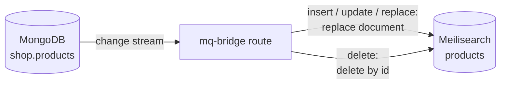

<!-- description: Keep a Meilisearch (or Typesense, Elasticsearch) index in sync with a MongoDB collection: the change stream feeds upserts and deletes, existing documents are copied first. Runnable docker-compose example. -->

# How to keep a search index in sync with MongoDB (change stream → Meilisearch)

One mq-bridge route copies a MongoDB collection into a Meilisearch index and then follows the
collection's change stream: an insert or update replaces the document in the index, a delete
removes it. It needs no Kafka and no code.

Runnable example: [`examples/mongodb-to-meilisearch`](https://github.com/marcomq/mq-bridge/tree/main/examples/mongodb-to-meilisearch).

## The problem: search results that disagree with the database

A product catalog lives in MongoDB; search runs on Meilisearch because it ranks, tolerates typos
and filters by facet. Keeping the index current is the part that goes wrong:

- **Writing to both from the application** misses every change made by a script, an admin tool or
  another service, and leaves the two apart when the second write fails.
- **A periodic re-index** shows prices and stock from the last run, and removes deleted products
  only when it rebuilds the whole index.
- **Polling an `updatedAt` field** needs that field on every write path and never sees a delete.

A MongoDB change stream reports every committed insert, update, replace and delete, whoever made
it, and can be resumed from a saved position.

## The solution: one route from the change stream to the index



MongoDB has to run as a replica set; a single member is enough. The route:

```yaml
products_to_search:
  input:
    mongodb:
      url: "mongodb://mongo:27017/?replicaSet=rs0"
      database: "shop"
      collection: "products"
      consume: capture_all          # copy existing documents, then follow the change stream
      cursor_id: "products-to-meili" # a restart resumes from the saved position
  output:
    middlewares:
      # A delete carries only `_id`, so it leaves as `{"id": ...}`; absent fields are left out.
      - transform:
          mapping:
            id: "$._id.$oid"
            name: "$.name"
            description: "$.description"
            price: "$.price"
            tags: "$.tags"
      - retry: { max_attempts: 5 }
    meilisearch:
      url: "http://meilisearch:7700"
      index: "products"
      primary_key: "id"
      operation: "${metadata:mongodb.operation}"
```

How it fits together:

- The [`mongodb`](../connectors/mongodb.md#reading) input with `consume: capture_all` reads every
  document first, then the change stream. The payload is the document as JSON, with an ObjectId
  written as `{"$oid": "…"}`; the operation is in the `mongodb.operation` metadata key (`insert`,
  `update`, `replace`, `delete`). An update carries the whole document after the change.
- `cursor_id` saves the stream position in the source database (collection
  `mqb_cursors_products`), so a restart neither copies the collection again nor misses changes.
  Use `checkpoint_store` instead when the bridge may not write to the source.
- The [`transform`](../cookbook/transform.md) turns the ObjectId into a plain string `id`, which
  is what Meilisearch accepts as a document id, and keeps only the fields that should be
  searchable. A collection with string `_id`s maps `id: "$._id"` instead.
- The [`meilisearch`](../connectors/meilisearch.md) output removes the document when the
  operation is `delete` and replaces it otherwise. It waits until Meilisearch has indexed each
  request before the change is acknowledged.

### Another search engine

The input and the `transform` stay the same. For Typesense or Elasticsearch, replace the output
with the [`http_bulk`](../connectors/http-bulk.md) recipe for that engine
([Typesense](../connectors/typesense.md), [Elasticsearch](../connectors/elasticsearch.md)) and
set its `operation` to `${metadata:mongodb.operation}`. Neither was run with a MongoDB source.

### Run the route from Rust or Python

The same file runs embedded in a service. In Rust, enable the `mongodb`, `http-bulk` and `yaml`
features and call `mq_bridge::deploy_file("routes.yaml")`; in Python,
`Route.from_file("routes.yaml", "products_to_search").run()`. The
[Qdrant use case](sync-postgres-to-qdrant.md#run-the-route-from-rust) shows both in full.

## Runnable example

```bash
git clone https://github.com/marcomq/mq-bridge && cd mq-bridge/examples/mongodb-to-meilisearch
docker compose up -d
./search.sh "hedphones"
```

The stack is MongoDB 8.2 as a single-member replica set, Meilisearch 1.53 and mq-bridge-app
1.0.1. `./test.sh` checks the copy, an insert, an update, a delete, a change made while the
bridge was stopped, and a misspelled search; it runs in CI.

## Failure semantics

| Event | What happens |
| :--- | :--- |
| **mq-bridge restarts** | It resumes the change stream from the position saved under `cursor_id`. Changes made while it was down arrive after the restart, as long as they are still in the oplog. |
| **The oplog has moved on** | A change stream can only resume while its position is still in the oplog. After a longer outage the resume fails; delete the saved position and copy the collection again. Size the oplog for the longest outage you want to survive. |
| **Duplicates** | Delivery is [at-least-once](../engine/delivery.md). A change can arrive twice after a crash, and a document changed during the first copy can arrive both from the copy and from the stream. Each write replaces the document by its id, so the index converges. |
| **Deletes** | A delete event carries only `_id`. The `transform` keeps that as `id`, which is all Meilisearch needs to remove the document. |
| **Meilisearch unavailable** | `retry` repeats the request. A change is acknowledged only after Meilisearch reported the indexing task as done, so unconfirmed changes are read again. While Meilisearch is down, the route waits and logs a warning every minute. |
| **A document Meilisearch refuses** | A failed task fails the whole request, so every document of that batch. Add a [`dlq`](../cookbook/dlq.md) after `retry` to keep them. |

Limits of this recipe:

- **The copy is not resumable.** `capture_all` reads the collection again if the bridge stops
  before the copy finished. A large collection is better copied once with
  [`mqb copy`](../reference/cli.md) and then followed with `consume: capture_new`.
- **One collection per route.** Run one route per collection and index.
- **Joined fields go stale.** A field copied from another collection does not change when that
  collection changes. The [Meilisearch page](../connectors/meilisearch.md#one-document-from-several-tables)
  describes the trade-off.
- **Index settings** (searchable, filterable and sortable attributes) are not set by the route.
  Apply them once before the first document, as the
  [Meilisearch page](../connectors/meilisearch.md#1-apply-index-settings-before-the-first-document)
  shows.

## When not to use mq-bridge for this

- **You are on MongoDB Atlas and Atlas Search is enough.** Its index is maintained by the
  database itself; there is nothing to sync.
- **The index needs data from several collections in one document, kept current.** That is a
  join over changing data; a worker of your own, or a stream processor, models it better than a
  per-collection route.
- **MongoDB runs standalone** and cannot become a replica set. Change streams are not available
  then; a periodic `consume: snapshot` copy is the most this route can do.

## Alternatives

| | mq-bridge | meilisync | Redpanda Connect |
| :--- | :--- | :--- | :--- |
| MongoDB change stream | `mongodb` input, `capture_all` / `capture_new` | yes | [`mongodb_cdc` input](https://docs.redpanda.com/connect/components/inputs/mongodb_cdc/); its page states that it requires an enterprise license |
| Meilisearch | built-in `meilisearch` output | yes, its only target | the generic `http_client` output |
| Other targets | Typesense, Elasticsearch, Qdrant and any bulk HTTP API, plus brokers, databases and files | Meilisearch only | many |
| Runs as | library in a Rust, Python or Node.js process, or one binary | Python program | one binary |

[meilisync](https://github.com/long2ice/meilisync) is a small Python tool made for exactly this
sync, also from MySQL and PostgreSQL; its repository shows no change since April 2025. mq-bridge
covers the same route and keeps working when the target or the source changes, for example to
send the same changes to Kafka as well (a [`fanout`](../cookbook/fanout.md) output).
