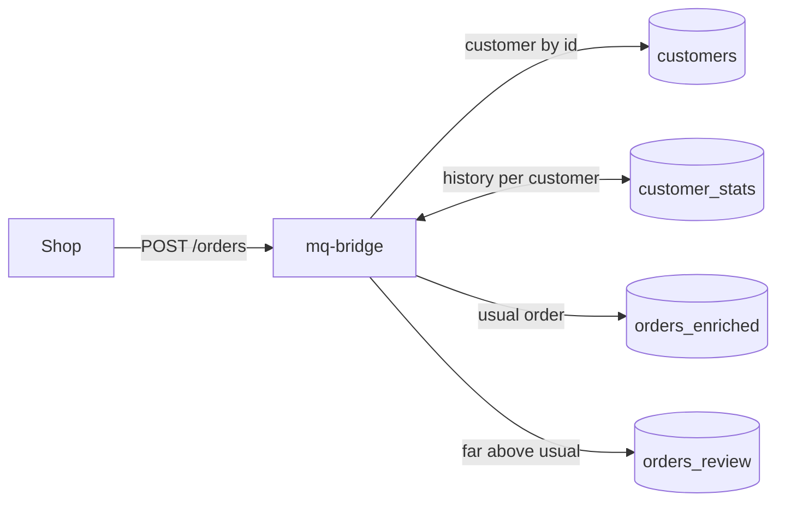

# Order features: enrich, keep per-customer history, flag outliers

Orders arrive on an HTTP endpoint. Each one is enriched with its customer from Postgres
(`lookup`), gets the customer's history so far (`aggregate`: order count, total spend, a moving
average of the amount, a seven-day decayed spend), and is written to Postgres. An order more than
three times the customer's usual amount goes to a review table instead.

The history is kept in Postgres, not in the bridge's memory: a restart continues where it
stopped, and several instances can share it.

Explained in the book: [Enrich events and keep per-key history](https://marcomq.github.io/mq-bridge/use-cases/enrich-and-aggregate-orders.html).



## Run it

Needs Docker and `curl`.

```bash
docker compose up -d
curl -sS http://localhost:8080/orders -H 'Content-Type: application/json' \
  -d '{"id": 1, "customer_id": 1, "amount": 40, "created_at": "2026-10-01T10:00:00Z"}'
docker compose exec postgres psql -U app -d app -c 'SELECT id, amount, customer, history FROM orders_enriched'
```

`./test.sh` posts five orders with a restart in between and checks the history, the review
table and the stored states; it is what CI executes. `docker compose down -v` removes everything.

## Files

| File | Purpose |
| :--- | :--- |
| [`routes.yaml`](routes.yaml) | The route: `http` input, `lookup`, `aggregate` with a Postgres store, `switch` to two tables |
| [`docker-compose.yml`](docker-compose.yml) | Postgres 16, mq-bridge-app 1.0.1 |
| [`init.sql`](init.sql) | The `customers` table with two rows and the two order tables |

The `customer_stats` table is created by the bridge on start.
