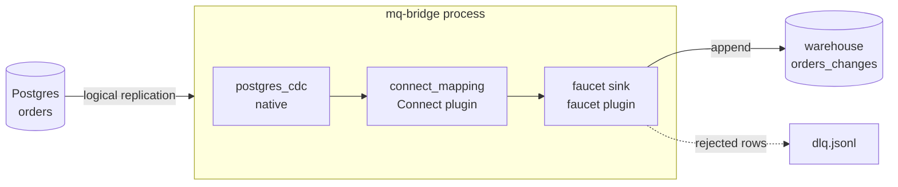

# Postgres CDC → Bloblang → warehouse change log

One route that uses three ecosystems in one process: mq-bridge reads a Postgres table through
logical replication, a [Redpanda Connect](https://docs.redpanda.com/redpanda-connect/) Bloblang
mapping reshapes each row, and a [faucet](https://github.com/PawanSikawat/faucet-stream) sink
appends it to a warehouse table. Existing rows are copied first.

In the example the warehouse is a second Postgres written by faucet's `postgres` sink, so it runs
offline. For Snowflake you change only the sink block; see
[the book page](https://marcomq.github.io/mq-bridge/use-cases/cdc-to-warehouse.html).

Explained in the book: [Stream Postgres changes into a warehouse](https://marcomq.github.io/mq-bridge/use-cases/cdc-to-warehouse.html).



## Run it

Needs Docker. The first build downloads the two plugin libraries (about 150 MB compressed).

```bash
docker compose up -d --build
docker compose exec warehouse psql -U dw -d dw -c "SELECT * FROM orders_changes"
```

Then change the source table and look again:

```bash
docker compose exec postgres psql -U app -d app -c "UPDATE orders SET status = 'paid' WHERE customer = 'ada'"
docker compose exec postgres psql -U app -d app -c "DELETE FROM orders WHERE customer = 'linus'"
```

`./test.sh` runs the whole sequence (copy, update, delete, insert, restart, a row the warehouse
rejects) and is what CI executes. `docker compose down -v` removes everything.

## Files

| File | Purpose |
| :--- | :--- |
| [`routes.yaml`](routes.yaml) | The route: `postgres_cdc` input, `connect_mapping` middleware, `retry` + `dlq`, faucet `postgres` sink |
| [`Dockerfile`](Dockerfile) | The mq-bridge-app 1.2.0 binary on Ubuntu 24.04, with mq-bridge-connect 0.2.2 and mq-bridge-faucet 0.1.1 from their release archives |
| [`docker-compose.yml`](docker-compose.yml) | Source Postgres 16, warehouse Postgres 16, the bridge |
| [`init.sql`](init.sql) | The `orders` table, its publication and three rows |
| [`warehouse.sql`](warehouse.sql) | The append-only `orders_changes` table, with a `CHECK` the test uses to provoke a rejected row |

## Plugins in a container

The app searches `/usr/local/lib/mq-bridge` for plugins. Two things in the `Dockerfile` apply to
other plugin images too:

- **Ownership.** Discovery loads only libraries owned by root or the running user. The archives
  store uid 1001, which `tar` keeps when it runs as root, so it unpacks with `--no-same-owner`.
- **glibc and system libraries.** The official app image is distroless Debian 12 (glibc 2.36).
  faucet 0.1.1's arm64 library needs glibc 2.39 and links `libsasl2.so.2`, so the image copies
  the app binary onto Ubuntu 24.04 and installs `libsasl2-2`. The binary itself runs on any
  glibc from 2.36 on.
